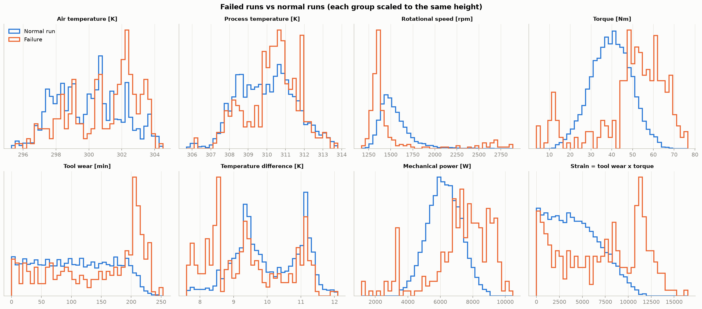
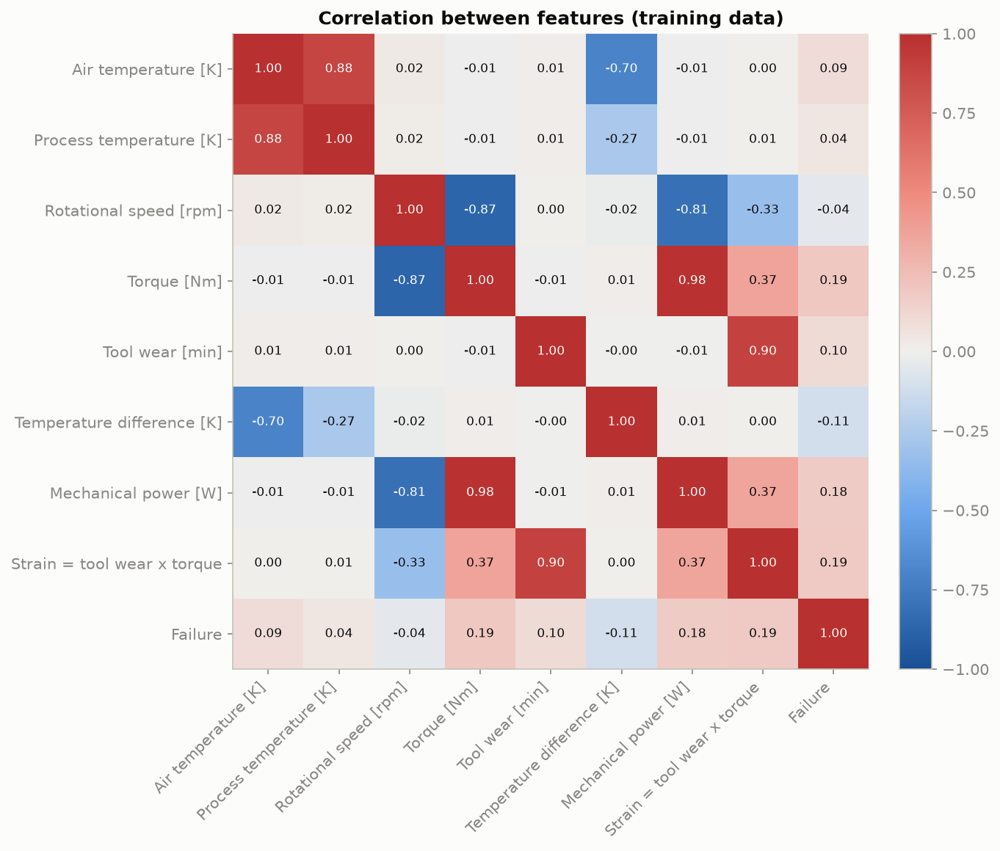
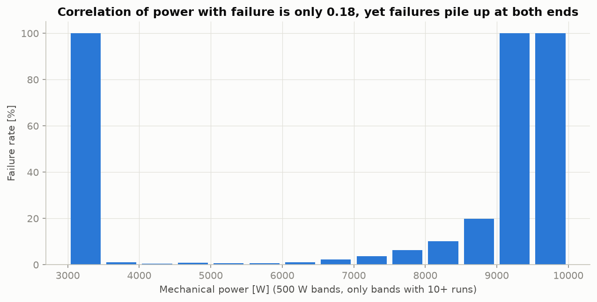
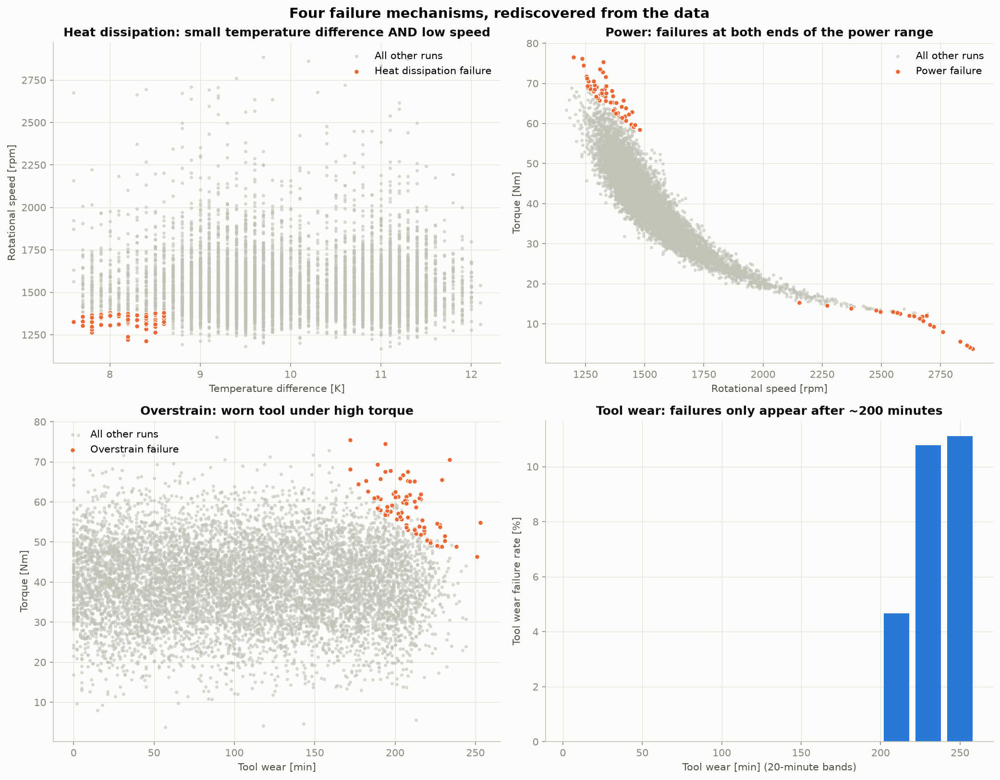
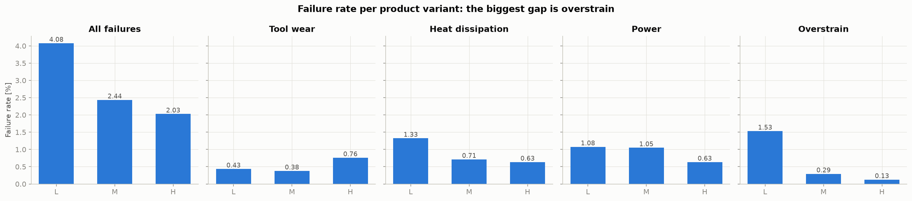

# 04 – EDA Findings

Notebook: `notebooks/02_eda.ipynb` · Code: `src/eda.py` · Figures: `reports/figures/`

**All EDA was done on the training data only** (8,000 runs, 271 failures), so the
test set stays truly unseen.

## 1. Physics-based features
Three features were engineered from domain knowledge of the milling process:

| Feature | Formula | Physical meaning |
|---|---|---|
| Temperature difference [K] | process temp − air temp | Small → heat is not carried away |
| Mechanical power [W] | torque × speed × 2π / 60 | How hard the machine works |
| Strain [Nm·min] | tool wear × torque | Stress on a worn tool |

## 2. Failed runs vs. normal runs

| Variable (median) | Normal run | Failure |
|---|---|---|
| Torque [Nm] | 39.8 | 53.2 |
| Tool wear [min] | 106 | 166 |
| Strain | 3,948 | 7,752 |
| Rotational speed [rpm] | 1,507 | 1,366 |
| Temperature difference [K] | 9.8 | 9.3 |
| Mechanical power [W] | 6,244 | 7,560 |

Failed runs work under higher torque, with more worn tools and at lower speed.

## 3. Correlation and its blind spot

- Every feature correlates **weakly** with failure (all below 0.2 in absolute value;
  power: 0.18).
- Speed and torque correlate strongly (−0.87): at roughly constant power, higher speed
  means lower torque. That is physics, not a data error.

**Lesson:** power failures happen when power is too **low or too high**. The two ends
cancel out in a correlation coefficient, so a weak correlation does *not* mean a weak
relationship. Plot first, then trust numbers.

## 4. Four failure mechanisms, rediscovered from the data

| Failure type | When it occurs (training data) | Predictable? |
|---|---|---|
| Heat dissipation (HDF) | Temperature difference ≤ 8.6 K **and** speed ≤ 1,379 rpm | Yes: sharp limit |
| Power (PWF) | Power ≤ ~3,480 W **or** ≥ ~9,000 W | Yes: sharp limits |
| Overstrain (OSF) | Strain above a limit that depends on the variant: ≈11,000 (L), ≈12,300 (M), ≈13,600 (H) | Yes: sharp limit |
| Tool wear (TWF) | Only after ~200 min of wear, but at a random moment after that | Only partly |

In the training data, every heat, power and overstrain failure falls inside these
limits. This is a property of the synthetic dataset; on a real machine the limits
would be noisier and drift over time.

## 5. Association vs. causation: why do L products fail more?

| Variant | All failures | Tool wear | Heat | Power | Overstrain |
|---|---|---|---|---|---|
| L | 4.08% | 0.43% | 1.33% | 1.08% | **1.53%** |
| M | 2.44% | 0.38% | 0.71% | 1.05% | 0.29% |
| H | 2.03% | 0.76% | 0.63% | 0.63% | **0.13%** |

L fails 2.05 percentage points more often than H. The largest part of that gap
(1.40 points) is **overstrain**, and the mechanism explains it: **L products have a
lower strain limit**. Heat and power failures differ a little as well, but their limits
are identical for all variants, and H has only about 800 training runs, so a few cases
move its rate considerably.

**Actionable conclusion:** not "L products are bad", but "torque limits or tool-change
intervals should depend on the product variant, because L products tolerate less strain."

## 6. Consequences for modeling
1. Compare **raw sensors** vs. **sensors + physics features**.
2. Sharp limits favour **tree-based models**, which learn thresholds.
3. Build an **expert-rules baseline** from these limits; the ML model must beat it.
4. Expect most missed failures to be **tool-wear failures**.
