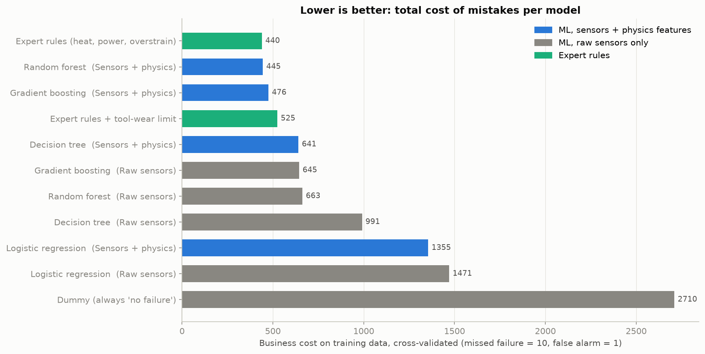
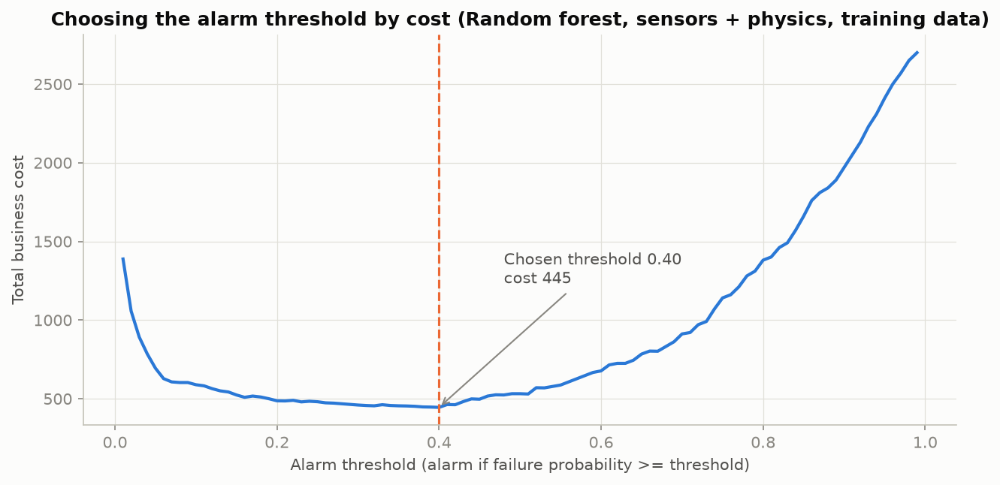
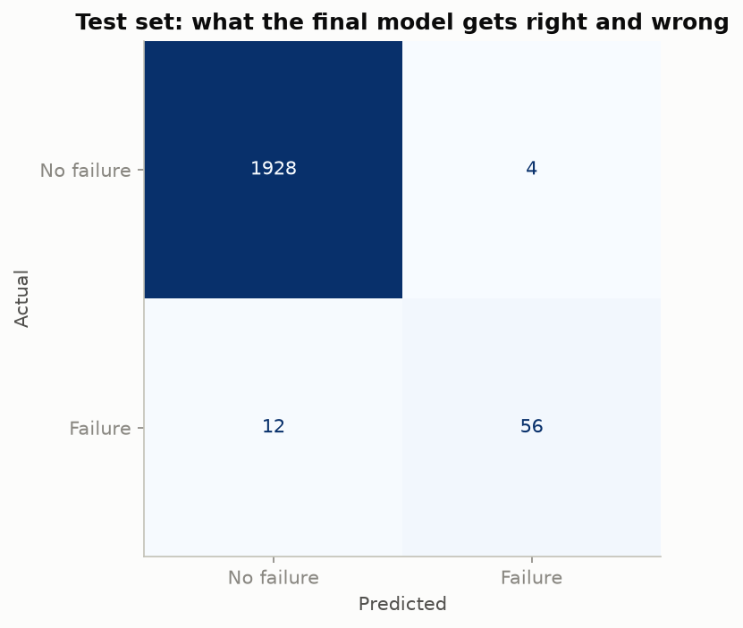
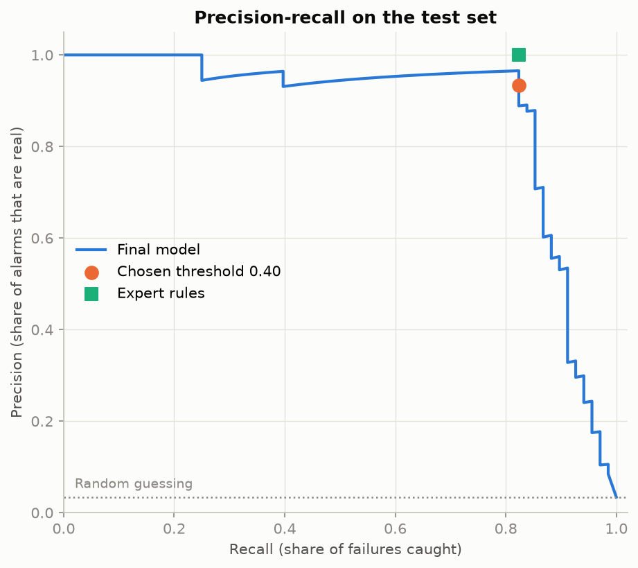

# 06 – Modeling and Evaluation

Notebook: `notebooks/03_modeling.ipynb` · Code: `src/train.py`, `src/modeling.py`, `src/rules.py`

## 1. Method
1. Five candidate models, from simple to powerful, each on two feature sets
   (raw sensors vs. sensors + physics features).
2. Two baselines: **always "no failure"** and **expert rules** built from the EDA limits
   (thresholds learned from training data only).
3. **5-fold stratified cross-validation** on the training data: every training run gets
   a prediction from a model that never saw it.
4. For each model, the **alarm threshold with the lowest business cost**
   (missed failure = 10, false alarm = 1).
5. The best model is retrained on all training data and evaluated **once** on the test set.

## 2. Cross-validated comparison (training data, 271 failures)

| Model | Features | PR-AUC | Recall | Precision | Missed | False alarms | Cost |
|---|---|---|---|---|---|---|---|
| Expert rules (heat, power, overstrain) | Physics limits | – | 0.84 | 1.00 | 44 | 0 | **440** |
| **Random forest** | Sensors + physics | **0.894** | 0.85 | 0.90 | 42 | 25 | **445** |
| Gradient boosting | Sensors + physics | 0.885 | 0.83 | 0.90 | 45 | 26 | 476 |
| Expert rules + tool-wear limit | Physics limits | – | 0.96 | 0.39 | 11 | 415 | 525 |
| Decision tree | Sensors + physics | 0.806 | 0.79 | 0.75 | 57 | 71 | 641 |
| Gradient boosting | Raw sensors | 0.789 | 0.82 | 0.58 | 48 | 165 | 645 |
| Random forest | Raw sensors | 0.756 | 0.81 | 0.61 | 52 | 143 | 663 |
| Decision tree | Raw sensors | 0.547 | 0.72 | 0.46 | 76 | 231 | 991 |
| Logistic regression | Sensors + physics | 0.453 | 0.62 | 0.35 | 104 | 315 | 1,355 |
| Logistic regression | Raw sensors | 0.434 | 0.57 | 0.33 | 116 | 311 | 1,471 |
| Dummy (always "no failure") | – | 0.034 | 0.00 | – | 271 | 0 | 2,710 |

### What the table teaches
- **Feature engineering beats algorithm choice.** Adding three physics features lowers the
  random forest's cost from 663 to 445 and raises PR-AUC from 0.756 to 0.894.
- **Tree models win** because failures follow sharp limits; a straight-line model like
  logistic regression cannot represent "too low *or* too high".
- **ROC-AUC can flatter weak models.** Random forest on raw sensors has a ROC-AUC of 0.970,
  close to the best model's 0.976, but its PR-AUC is far lower (0.756 vs. 0.894). With rare
  failures, PR-AUC is the more honest ranking metric.
- **The expert rules are as good as the best ML model.** This synthetic dataset was generated
  from such physical limits, and the EDA rediscovered them. On a real machine the limits are
  unknown, noisy and drift, and the ML model learns them from data, while rules must be found
  and maintained by experts.
- **The tool-wear rule is a bad deal:** it catches 33 more failures but raises 415 false alarms.

## 3. Alarm threshold

For the random forest, the cheapest threshold on the training data is **0.40**
(not the default 0.5). The cost stays within about 4% of the minimum between 0.30 and
0.42 (445–463), but rises quickly above 0.43 (about 500 at 0.44). Because 0.40 sits near
that edge, a slightly lower threshold (around 0.35) would be the safer choice in
production if real data turns out noisier: almost the same cost, more margin before
missed failures increase.

## 4. Final evaluation on the test set (used once, 68 failures)
| Model | Recall | Precision | Caught | Missed | False alarms | Cost |
|---|---|---|---|---|---|---|
| **Random forest (sensors + physics), threshold 0.40** | **0.82** | **0.93** | 56 | 12 | 4 | 124 |
| Expert rules (heat, power, overstrain) | 0.82 | 1.00 | 56 | 12 | 0 | 120 |
| Expert rules + tool-wear limit | 0.96 | 0.33 | 65 | 3 | 132 | 162 |
| Dummy (always "no failure") | 0.00 | – | 0 | 68 | 0 | 680 |

Test PR-AUC 0.876, ROC-AUC 0.978. The success criterion of **≥ 80% recall is met**,
with only 4 false alarms in 2,000 runs. The test results match the cross-validation
results closely, so the model is not overfitted.

## 5. Which failures are missed?
| Missed on test set | Count |
|---|---|
| Tool wear (TWF) | 9 of 10 |
| Heat dissipation (HDF) | 1 of 29 |
| Power (PWF) | 0 of 13 |
| Overstrain (OSF) | 0 of 16 |
| No type given | 2 |

Across all 10,000 runs (cross-scored for the dashboard), **42 of the 54 missed failures
are tool-wear failures.** They happen at a random moment after ~200 minutes of wear, so
a snapshot of sensor values cannot predict them.

## 6. Failure-type model
A multi-label random forest (one yes/no output per type) trained on failed runs only.
On the 66 test failures with a known type, the **top predicted type is correct for 97%**.

| Type | Test cases | Recall | Precision |
|---|---|---|---|
| Tool wear | 10 | 0.70 | 1.00 |
| Heat dissipation | 29 | 1.00 | 1.00 |
| Power | 13 | 1.00 | 1.00 |
| Overstrain | 16 | 1.00 | 0.89 |

Test sets this small make these numbers uncertain (one case changes tool-wear recall by 10 points).
