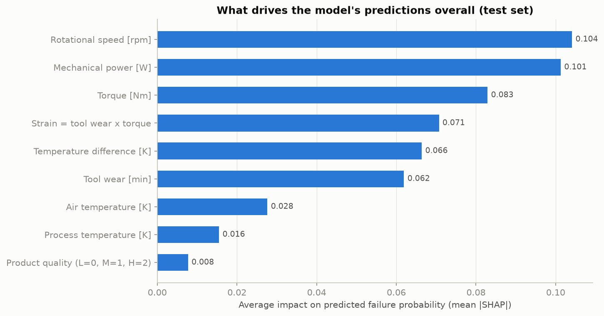
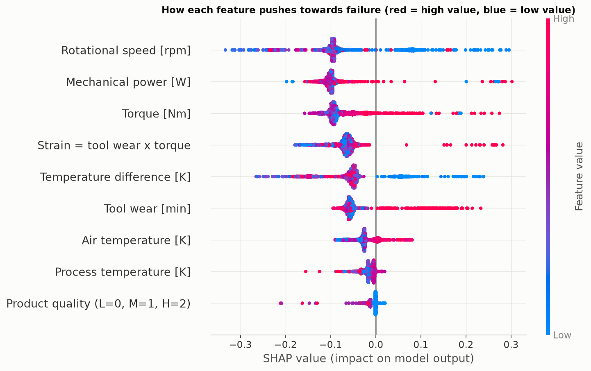
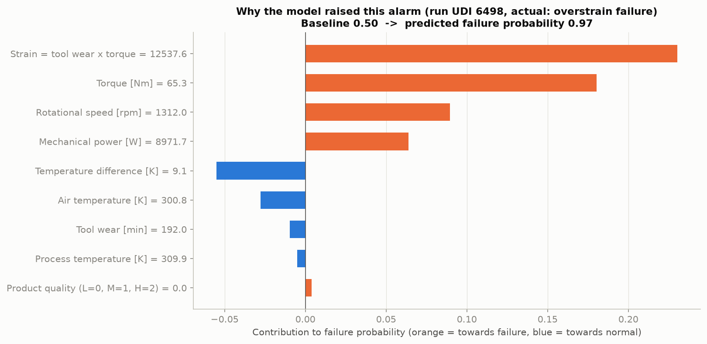
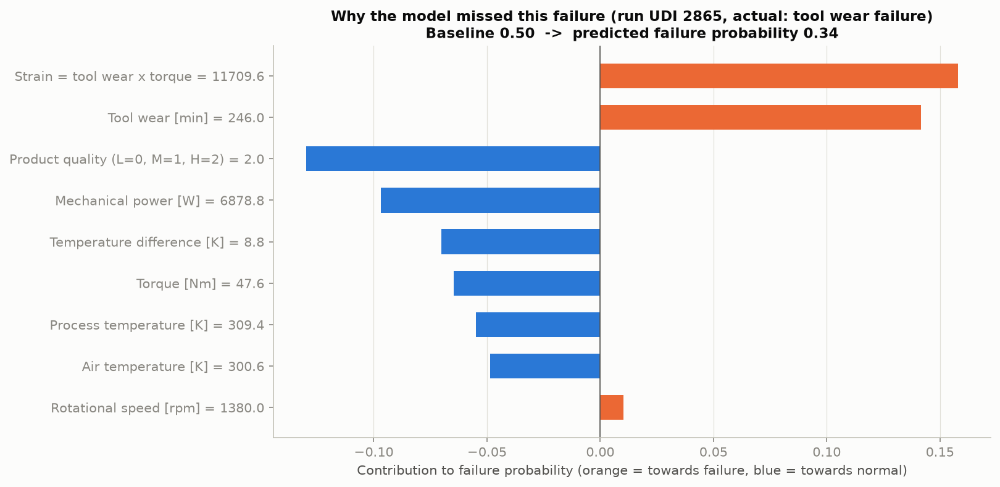

# 07 – Explainability

Notebook: `notebooks/04_explainability.ipynb` · Code: `src/explain.py`

A technician will not act on "risk 0.97" without a reason (requirement NFR2).
**SHAP** splits every prediction into a contribution per feature:

> risk score = baseline + contribution of feature 1 + contribution of feature 2 + …

The baseline is 0.50 rather than 0.034 because the model was trained with class weights
(see `05_preprocessing.md`): the output is a risk score, not a calibrated probability.

## 1. What drives the predictions overall (test set)

| Feature | Mean impact (mean \|SHAP\|) |
|---|---|
| Rotational speed | 0.104 |
| Mechanical power | 0.101 |
| Torque | 0.083 |
| Strain | 0.071 |
| Temperature difference | 0.066 |
| Tool wear | 0.062 |
| Air temperature | 0.028 |
| Process temperature | 0.016 |
| Product quality | 0.008 |

The top features are exactly the variables behind the four failure mechanisms from the
EDA, so the model learned the physics rather than a coincidence. Product quality matters
little on its own; its effect runs through the strain limit.

## 2. One alarm, explained (run UDI 6498, actual: overstrain failure)

Risk score 0.97. The largest contributions are **strain** (+0.23) and **torque** (+0.18):
a worn tool (192 min) under high load (65.3 Nm). A technician reading this knows what to
check: the tool and the load.

## 3. One miss, explained (run UDI 2865, actual: tool-wear failure)

Risk score 0.35, just below the 0.40 threshold. High strain (+0.16) and tool wear (+0.14)
push towards failure, but the product quality and normal power pull it back. Many runs
with similar wear do *not* fail, because tool-wear failures happen at a random moment.
The model's reasoning is sensible; the limit lies in the data, which supports the
recommendation of planned tool changes (see `09_results_and_recommendations.md`).

## 4. Two kinds of explanation in the dashboard
- **Model view:** SHAP, which shows what the ML model relied on.
- **Rule view:** for every run, the dashboard also lists which physical limit was exceeded
  (column `alarm_reason`), which is often the explanation technicians find easiest to act on.
